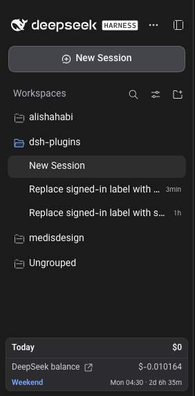
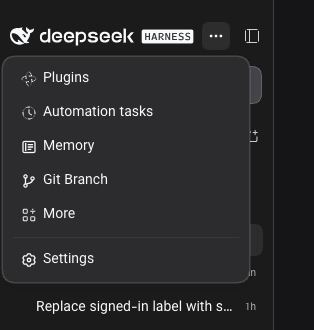

# dsh-client-ui-settings-button

Declutters the DeepSeek Harness sidebar for the Web GUI and the desktop app:

- the **Signed in to DeepSeek** account row and its Settings / Contact us / Sign out popup are gone
  (the `settings.launcher` cell is claimed at a shadowing priority);
- the global panel row (**Plugins**, **Automation tasks**, **More**, plus any other pinned panel) and
  the **Settings** action move into one popover behind a `⋯` button next to the brand mark;
- the sidebar keeps New Session, the workspace/session list and, in the collapsed rail, its own
  compact navigation.

| Decluttered sidebar | The menu |
|---|---|
|  |  |

## How it works

Everything is the shell's own UI, moved rather than reimplemented:

- **Launcher** — `settings.launcher` is a `single` slot: entries sort by ascending priority, the
  first one renders, and registering at an occupied priority throws. This plugin registers at
  `priority: -1`, which shadows the shipped account menu (`dsh-client-ui-settings-account`, default
  `0`) without touching any shipped file. The occupant publishes its `openSettings` callback and
  localized `trigger` label, then renders nothing while the menu owns the row.
- **Panel list** — the shipped `<nav>` (a direct child of `[data-sidebar-scrollport]`) is adopted into
  the popover, so panel switching, the active-row state, unpinning and the More fly-out behave
  exactly as before. The popover lives inside `#root` because React delegates every synthetic event
  to that container: a row moved to `document.body` would render and hover but never click.
- **Trigger** — inserted into the brand row (`[data-window-drag]` next to the mark) and marked
  `-webkit-app-region: no-drag`, because on macOS that row is the window-drag surface.
- **Collapse** — the expanded column keeps its width while the frame clips it, so width is not a
  usable signal; the plugin follows the shell's `data-sidebar-collapsed` marker. In the rail the
  navigation and the footer Settings control are the shell's own again.
- **Failure paths** — a missing slot seat, a rejected registration, a missing panel list, or a
  tooltip that cannot render each leave the sidebar as it was; the Settings action still opens even
  when the panel list cannot be adopted.

## Behavior to know about

- **Sign out / Contact us / Sign in** live only in the account menu this plugin replaces. Settings →
  Account still shows profile, balance, top-up and usage, but has no sign-out action. Disable the
  plugin when you need that menu.
- **The rail keeps native behavior** (icon-only panel rows and the gear), because the brand-row
  trigger is not rendered there.
- Changes are picked up on the next window reload (or app restart for the desktop app).

## Install

```sh
dsh plugin --profile web add dsh-client-ui-settings-button          # npm
dsh plugin --profile desktop add dsh-client-ui-settings-button

dsh plugin --profile web add github:ali-shahabi/dsh-client-ui-settings-button#v0.1.0
dsh plugin --profile desktop add link:$PWD                          # local working copy

dsh plugin --profile web remove dsh-client-ui-settings-button
```

Restart DSH after changing it: the profile roster is composed at boot.

## Build / test

```sh
node scripts/build-client.js          # regenerate lib/client.js from src/client/*.js
node scripts/build-client.js --check  # guard against a stale bundle
node --test "tests/*.test.js"         # registration, markup and fallback tests

node scripts/build-fixture.js         # harness pages for both brand-row shapes
```

`scripts/build-fixture.js` writes two static pages — `desktop` (macOS: window-chrome strip holds the
collapse toggle, brand row is a separate sibling) and `browser` (toggle inside the brand row) — each
embedding the built bundle with stub loader/React/context. Open one and read `#out`: it prints
`PASS`/`FAIL` with the placement checks, which is how the desktop DOM shape is verified without the
Electron app.

## Layout

| File | Role |
|---|---|
| `src/index.js` | Host half: a roster entry only — no tools, routes or state. |
| `src/client/menu.js` | Brand-row trigger, popover, panel-list adoption, collapse tracking. |
| `src/client/launcher.js` | The `settings.launcher` occupant: footer/rail button, publishing, tooltip. |
| `src/client/styles.js` | Injected stylesheet, expressed with the shell's design tokens. |
| `scripts/build-client.js` | Inlines `src/client/*.js` into one `window.__ModuleLoader__.load` call. |
| `scripts/build-fixture.js` | Static harness pages for the desktop and browser brand-row shapes. |

## License

Apache-2.0. See [LICENSE](LICENSE) and [NOTICE](NOTICE).
